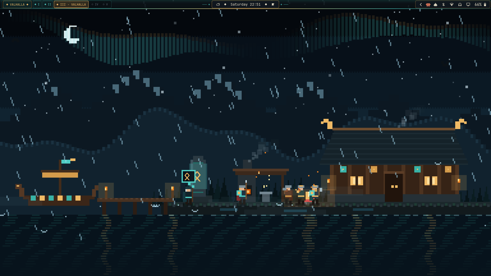
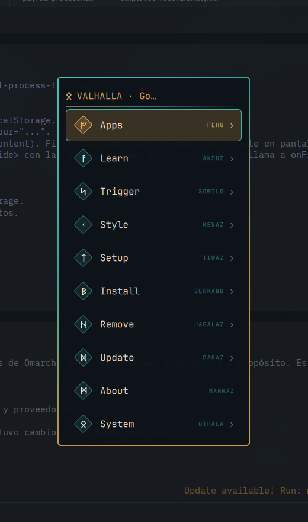
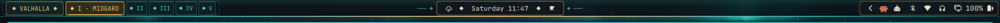

# ᛟ Hyprland Viking — Escritorio Pixel Art Nórdico Configurable

Entorno completo de escritorio inspirado en **Assassin's Creed Valhalla** para **Omarchy + Hyprland**, con una **arquitectura modular**: tema visual nórdico, barra HUD de brújula, menú con medallones rúnicos del *Elder Futhark* y un motor de **Live Wallpaper 16-bit Pixel Art** en tiempo real con **panel de configuración**: elegí la visualización, el clima, la hora del día, los efectos y tu ciudad.

> Antes llamado *Omarchy Valhalla*. El instalador migra automáticamente el plugin `gabriel.valhalla-world` al nuevo `gabriel.hyprland-viking`.

---

## 📸 Vista Previa

### 1. Live Wallpaper 16-Bit Pixel Art + HUD Bar


### 2. Menú con Medallones Rúnicos Elder Futhark (`gabriel.menu`)


### 3. Barra Superior HUD estilo Brújula (`gabriel.bar` + `gabriel.workspaces`)


---

## ⚙️ Panel de Configuración

Abrilo desde el menú de Omarchy (`Super + Alt + Space` → **Style** → **Hyprland Viking** → **Configuración**) o desde la terminal:

```bash
~/.config/omarchy/plugins/gabriel.hyprland-viking/hyprland-viking-ctl settings
```

`Esc` o clic fuera del panel lo cierra. Los cambios se aplican al instante y se guardan en `~/.config/hyprland-viking/config.json` (el instalador nunca lo pisa).

| Sección | Qué configura |
|---|---|
| **Visualización** | Escena activa: *Valhalla · Fiordo del Cuervo* (por defecto), *Batalla · Clan del Cuervo vs Sajones* o *Travesía · Drakkar en alta mar*. Se agregan más sin tocar el motor, ver [`scenes/README.md`](modules/world/gabriel.hyprland-viking/scenes/README.md). |
| **Clima y ciudad** | Modo manual (despejado / lluvia / tormenta / nieve) o automático, y tu ciudad. |
| **Hora del día** | Automático (según la hora real), noche, amanecer, día o atardecer. |
| **Efectos** | Los de la escena activa: aurora, relámpagos, cuervos, vikingos, estrellas, incendios, flechas y fauna marina; intensidad de la aurora y de lluvia/nieve. |
| **Rendimiento** | 8 / 12 / 24 fps (la velocidad de la animación no cambia) y apagar el fondo. |

Todo también se puede cambiar desde la CLI:

```bash
hyprland-viking-ctl scene valhalla
hyprland-viking-ctl city "Buenos Aires"
hyprland-viking-ctl time dusk            # auto | night | dawn | day | dusk
hyprland-viking-ctl preset storm         # rain | storm | snow | clear
hyprland-viking-ctl toggle
```

### Ejemplo de `config.json`

```json
{
  "scene": "valhalla",
  "performance": { "fps": 24 },
  "timeOfDay": { "mode": "auto" },
  "weather": { "mode": "manual", "condition": "rain", "city": "Buenos Aires" },
  "effects": { "aurora": true, "lightning": true, "ravens": true, "vikings": true, "stars": true,
               "auroraStrength": 1.0, "precipitation": 1.0 }
}
```

Los valores inválidos se corrigen solos al cargar, así que editar el archivo a mano nunca rompe el fondo.

---

## ⚔️ Escena de Batalla

Elegila en **Visualización**. Nórdicos del **Clan del Cuervo** (escudos azul noche con el cuervo en blanco hueso, ribete turquesa y boss dorado) contra sajones (escudos rojos y ocres), frente a una empalizada en llamas y un drakkar varado en la costa.

* Cada guerrero elige al enemigo más cercano, se acerca, ataca (preparar, golpear, recuperar), bloquea con el escudo, recibe daño y cae. Los campeones (el jefe nórdico con casco de cuernos y el *thegn* sajón) se buscan entre sí y muestran su barra de vida al ser heridos.
* Los arqueros disparan flechas en arco; algunas hieren, otras se clavan en el suelo. De noche, algunos sajones lanzan flechas incendiarias.
* Llegan refuerzos por la playa y por la puerta rota, así que la batalla nunca termina; los caídos quedan en el campo y los cuervos de Odín bajan a posarse sobre ellos.
* **Clic en el escritorio**: un rayo de Thor cae donde hagas clic. Abate a los sajones cercanos y los nórdicos lo celebran con una runa.
* Respeta la hora del día, el clima (lluvia, nieve, niebla, tormenta) y los efectos del panel (relámpagos, cuervos, incendios, flechas).

---

## ⛵ Escena de Travesía

El drakkar del Clan del Cuervo, a doble escala, surca el mar abierto: la tripulación boga al ritmo del tambor, el timonel gobierna con su remo y el vigía sopla el cuerno cuando avista algo.

* **Oleaje en paralaje**: el mar se desliza más rápido cuanto más cerca, con estela y espuma de proa. El cabeceo del barco crece con el viento y la lluvia.
* **Eventos**: una ballena emerge a lo lejos, lanza su chorro y se sumerge; pasan islas con una baliza encendida. La tripulación reacciona con runas.
* **Cielo cambiante** (noche, amanecer, día, atardecer) con la luna o el sol reflejados en el agua, gaviotas de día y los cuervos de Odín. Un cuervo vigila desde el mástil y se va volando cuando cae un rayo.
* **Clic en el escritorio**: cae un rayo de Thor en el mar; si cae cerca del barco, la tripulación lo celebra.

---

## 🏗️ Arquitectura Modular

```text
hyprland-viking/
├── install.sh                         # Instalador modular por componentes (--all, --theme, --bar, --menu, --world, --configs)
├── README.md                          # Documentación general y guía de arquitectura
├── assets/
│   └── screenshots/                   # Capturas reales del entorno funcionando
├── scripts/
│   ├── backup.sh                      # Respaldo automático de la configuración previa
│   ├── uninstall.sh                   # Desinstalación limpia y restauración del backup
│   └── weather-api-sync.sh            # Conector de clima real con Open-Meteo API
└── modules/
    ├── theme/
    │   └── valhalla/                  # Paleta Raven Clan (Teal Aurora, Oro Animus, Pizarra Nórdica) y wallpapers
    ├── bar/
    │   ├── gabriel.bar/               # Barra HUD estilo AC Valhalla con cápsula central y diamantes dorados
    │   └── gabriel.workspaces/        # Espacios de trabajo nombrados según los Nueve Reinos (MIDGARD, ASGARD, etc.)
    ├── menu/
    │   └── gabriel.menu/              # Menú del sistema con medallones de runas vikingas y buscador nativo de Apps
    ├── world/
    │   └── gabriel.hyprland-viking/   # Motor Live Wallpaper configurable (WlrLayer.Background)
    │       ├── manifest.json          # Metadatos del plugin de servicio Quickshell
    │       ├── Service.qml            # Orquestador: config, escena activa, IPC, capas Wayland
    │       ├── hyprland-viking-ctl    # CLI sobre el IPC (settings, preset, scene, city, time...)
    │       ├── config/
    │       │   ├── Config.js          # Valores por defecto, validación y persistencia de ajustes
    │       │   └── weather.default.json
    │       ├── core/
    │       │   ├── WeatherController.js # Normalizador de estado de clima y presets
    │       │   └── TimeOfDay.js         # Resuelve auto/noche/amanecer/día/atardecer
    │       ├── scenes/
    │       │   ├── Registry.js        # Lista de visualizaciones disponibles
    │       │   ├── README.md          # Cómo agregar una escena
    │       │   ├── shared/Atmosphere.js # Estrellas, aurora, rayos, lluvia, nieve y niebla reutilizables
    │       │   ├── battle/            # Escena de batalla: Clan del Cuervo vs sajones
    │       │   │   ├── Scene.js, Layout.js, Palettes.js
    │       │   │   ├── Backdrop.js, Renderer.js, Fighters.js
    │       │   │   └── Simulation.js  # IA de combate, flechas, refuerzos y cuervos
    │       │   ├── voyage/            # Escena de travesía: drakkar a doble escala en alta mar
    │       │   │   ├── Scene.js, Layout.js, Backdrop.js
    │       │   │   └── Renderer.js, Simulation.js  # oleaje, tripulación, ballena, islas
    │       │   └── valhalla/          # Escena por defecto
    │       │       ├── Scene.js, Palettes.js
    │       │       ├── BackdropRenderer.js  # Escenario estático (cielo, Langhús, forja, muelle)
    │       │       ├── EntityRenderer.js    # Vikingos, drakkar, agua, clima, aurora
    │       │       └── WorldSimulation.js   # IA de vikingos, cuervos y partículas
    │       └── ui/                    # Panel de configuración (QML) y sus controles
    └── configs/
        ├── omarchy/                   # shell.json, extensiones de menú y branding ASCII
        ├── hypr/                      # Bordes dorados/turquesa en looknfeel.lua y pantalla de bloqueo Hyprlock
        └── fastfetch/                 # Arte ASCII del Clan del Cuervo y métricas con runas
```

---

## 🚀 Instalación

### Instalar todo el entorno (con backup automático)
```bash
cd ~/omarchy-valhalla
./install.sh
```

### Instalar módulos individuales
Puedes instalar o actualizar únicamente los módulos que desees:
```bash
./install.sh --theme      # Solo el tema de colores y fondos
./install.sh --bar        # Solo la barra HUD y los 9 Reinos
./install.sh --menu       # Solo el menú con medallones rúnicos
./install.sh --world      # Solo el Live Wallpaper 16-bit Pixel Art
./install.sh --configs    # Solo las configs de Hyprland, Hyprlock y Fastfetch
```

### Desinstalar y restaurar estado original
```bash
./install.sh --uninstall
```

---

## 🌦️ Clima y Ciudad

El clima tiene dos modos (sección **Clima y ciudad** del panel):

* **Manual**: elegís despejado, lluvia, tormenta o nieve. También con `hyprland-viking-ctl preset <rain|storm|snow|clear>` o desde el menú de Omarchy.
* **Automático**: el clima lo define un proveedor externo que escribe en `~/.config/hyprland-viking/weather.json` (el plugin lo vigila en vivo). **Todavía no hay un proveedor elegido**: la ciudad que ingreses se guarda y se muestra como ubicación, lista para cuando se conecte uno.

Mientras tanto podés usar el script de ejemplo [`scripts/weather-api-sync.sh`](scripts/weather-api-sync.sh), que consulta **Open-Meteo** (sin API key) por coordenadas y escribe ese archivo:

```bash
./scripts/weather-api-sync.sh -34.6037 -58.3816 "Buenos Aires"
```

Solo tiene efecto con el modo **Automático** activado. Podés ejecutarlo cada 15 minutos con un timer de usuario o cron.
